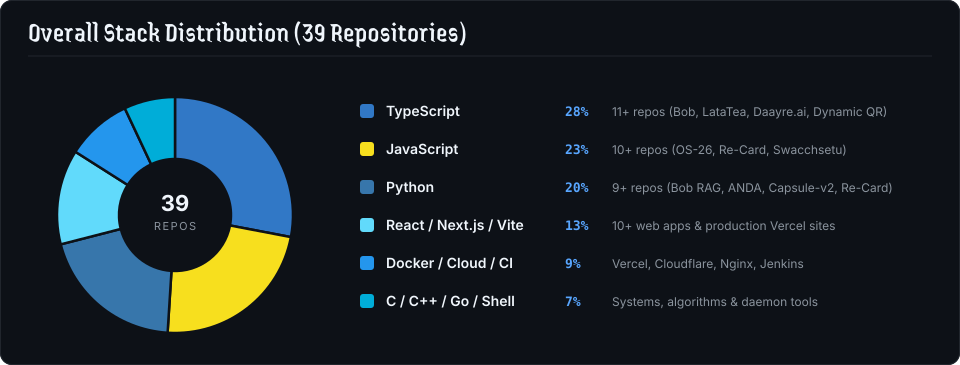

<div align="center">


<br />

<sub>Designing low-latency interactive systems, kernel-level simulations, agentic AI infrastructure, and production web platforms.</sub>

<br /><br />

[](https://interactive-portfolio-six-eta.vercel.app)
[](https://os26-tejaskp.vercel.app)
[](https://bob-pokedex.vercel.app)
[](mailto:punyaptejaskumar@gmail.com)

</div>

<br />


<br />

* Building low-latency retrieval & voice-enabled AI pipelines (`FastAPI`, `LanceDB`, `Groq LPU`)
* Engineering interactive 3D hardware & OS algorithm visualizers (`Three.js`, `WebGL`, `Canvas`)
* Designing autonomous local daemons, edge proxies, and CI/CD release intelligence
* Full-stack TypeScript & Next.js production web architecture

<br />


<br />

### Languages

<p>
  <a href="#tech-stack" title="TypeScript — █████████░ 88% (11+ repos: Bob, LataTea, Daayre.ai, Dynamic QR)"></a>&nbsp;
  <a href="#tech-stack" title="JavaScript — ████████░░ 80% (10+ repos: OS-26, Re-Card, Swacchsetu, 00lens)"></a>&nbsp;
  <a href="#tech-stack" title="Python — ███████░░░ 74% (9+ repos: Bob RAG, ANDA, Capsule-v2, Re-Card)"></a>&nbsp;
  <a href="#tech-stack" title="C — ████░░░░░░ 42% (Systems & Algorithms: ccc-3-sem-project, SRMS-Project)"></a>&nbsp;
  <a href="#tech-stack" title="C++ — ███░░░░░░░ 30% (Data Structures & CLI Engines: 00lens)"></a>&nbsp;
  <a href="#tech-stack" title="Go — ███░░░░░░░ 28% (Microservices & Edge Proxies: ANDA)"></a>&nbsp;
  <a href="#tech-stack" title="Bash — ████░░░░░░ 40% (Build & Container Automation: ANDA, Capsule-v2)"></a>&nbsp;
  <a href="#tech-stack" title="PowerShell — ████░░░░░░ 40% (Windows Automation & Tooling: enhanced-winget, OS-26)"></a>
</p>

<br />

### Frontend & Graphics

<p>
  <a href="#tech-stack" title="React — ████████░░ 78% (Bob, LataTea, Daayre.ai, Velo Agent)"></a>&nbsp;
  <a href="#tech-stack" title="Next.js — ███████░░░ 70% (AlphaXGen, Dynamic QR, Enrique & Co.)"></a>&nbsp;
  <a href="#tech-stack" title="Vite — ███████░░░ 72% (Bob, LataTea, Daayre.ai, Interactive Portfolio)"></a>&nbsp;
  <a href="#tech-stack" title="Tailwind CSS — ████████░░ 80% (AlphaXGen, LataTea, Dynamic QR, Daayre.ai)"></a>&nbsp;
  <a href="#tech-stack" title="Three.js / WebGL — █████░░░░░ 50% (OS-26 3D Storage Visualizer)"></a>&nbsp;
  <a href="#tech-stack" title="HTML5 — ████████░░ 82% (Core Web & Canvas Platforms)"></a>&nbsp;
  <a href="#tech-stack" title="CSS3 — ████████░░ 80% (Custom Design Systems & Animations)"></a>
</p>

<br />

### Backend, AI & Databases

<p>
  <a href="#tech-stack" title="FastAPI — ███████░░░ 68% (Bob Voice RAG, Capsule-v2, Re-Card)"></a>&nbsp;
  <a href="#tech-stack" title="Flask — ████░░░░░░ 38% (ML & Python Web Microservices: Re-Card)"></a>&nbsp;
  <a href="#tech-stack" title="Node.js — ██████░░░░ 60% (Chat-YO, LataTea CMS, Next.js APIs)"></a>&nbsp;
  <a href="#tech-stack" title="Express.js — █████░░░░░ 50% (REST & WebSocket Backends: Chat-YO)"></a>&nbsp;
  <a href="#tech-stack" title="PostgreSQL — █████░░░░░ 52% (Capsule-v2 & Production Cloud DBs)"></a>&nbsp;
  <a href="#tech-stack" title="Supabase — █████░░░░░ 48% (Interactive Portfolio & Auth/Analytics)"></a>&nbsp;
  <a href="#tech-stack" title="SQLite — ██████░░░░ 62% (Capsule-v2, ANDA, Local State Stores)"></a>
</p>

<br />

### Cloud, DevOps & Tooling

<p>
  <a href="#tech-stack" title="Vercel — █████████░ 90% (10+ Live Production Deployments)"></a>&nbsp;
  <a href="#tech-stack" title="Cloudflare — █████░░░░░ 45% (Edge Workers & Tunnels: ANDA, Capsule-v2)"></a>&nbsp;
  <a href="#tech-stack" title="Docker — ███████░░░ 70% (Bob, ANDA, Capsule-v2, Re-Card, Enrique)"></a>&nbsp;
  <a href="#tech-stack" title="Nginx — ████░░░░░░ 40% (Reverse Proxy & Load Balancing: Capsule-v2)"></a>&nbsp;
  <a href="#tech-stack" title="Jenkins — ████░░░░░░ 42% (CI/CD Pipeline Automation: Capsule, Capsule-v2)"></a>&nbsp;
  <a href="#tech-stack" title="Git — ██████████ 98% (Daily Version Control Across 39+ Repos)"></a>&nbsp;
  <a href="#tech-stack" title="GitHub — ██████████ 98% (CI Workflows, Webhooks & Open Source)"></a>&nbsp;
  <a href="#tech-stack" title="Linux — ███████░░░ 70% (Container Runtimes, Fly.io & Cloud VMs)"></a>&nbsp;
  <a href="#tech-stack" title="VS Code — ██████████ 95% (Primary Systems & Full-Stack IDE)"></a>
</p>

<br />

<div align="center">
  
</div>

<br />


<br />

| Project | Domain | Stack | Live Deployment |
|:---|:---|:---|:---|
| **[OS-26](https://github.com/PTejasKr/OS-26)** | 3D Storage & Kernel Visualizer | Three.js, WebGL, Canvas, JS | [os26-tejaskp.vercel.app](https://os26-tejaskp.vercel.app) |
| **[Bob](https://github.com/PTejasKr/Bob)** | Sub-150ms Voice RAG Pokédex | FastAPI, LanceDB, Groq, React 19 | [bob-pokedex.vercel.app](https://bob-pokedex.vercel.app) |
| **[ANDA](https://github.com/PTejasKr/ANDA)** | Autonomous Desktop Daemon | Python, Go, Cloudflare, Docker | `Local / Fly.io` |
| **[Capsule-v2](https://github.com/PTejasKr/Capsule-v2)** | CI/CD Changelog & PR Engine | FastAPI, Celery, Nginx, SQLite | [capsule-v2.vercel.app](https://capsule-v2.vercel.app) |
| **[Re-Card](https://github.com/PTejasKr/Re-Card)** | Financial ML Document Parser | Python, Scikit-Learn, FastAPI | `Research / Docker` |
| **[Chat-YO](https://github.com/PTejasKr/Chat-YO)** | Ephemeral TTC WebSocket Chat | TypeScript, WebSockets, Vite | `Self-Hosted` |
| **[AlphaXGen](https://github.com/PTejasKr/alphaxgen)** | Print-on-Demand E-Commerce | Next.js, TypeScript, Tailwind | [alphaxgen.in](https://alphaxgen.in) |
| **[LataTea](https://github.com/PTejasKr/LataTea)** | Corporate Brand Platform | React, Vite, TypeScript | [latatea.vercel.app](https://latatea.vercel.app) |
| **[Daayre.ai](https://github.com/PTejasKr/Daayre.ai)** | Legal Document Workspace | React, TypeScript, Convex DB | [daayre-ai.vercel.app](https://daayre-ai.vercel.app) |
| **[Dynamic QR](https://github.com/PTejasKr/dynamic_qr)** | Dynamic QR & Analytics | Next.js 16, TypeScript, Tailwind | [dynamic-qr-opal.vercel.app](https://dynamic-qr-opal.vercel.app) |

<br />


<br />

<div align="center">


&nbsp;&nbsp;


</div>

<br />

<div align="center">


</div>

<br />

<div align="center">


</div>

<br />


<br />

```text
Systems & Kernel Simulation
Low-Latency Retrieval Architectures
Autonomous Agentic Infrastructure
Distributed Task Queues & CI/CD
Interactive WebGL / 3D Rendering
Security & Edge Networking
```

<br />

---

<div align="center">

**Punyap Tejas Kumar** &nbsp;•&nbsp; <a href="https://interactive-portfolio-six-eta.vercel.app">Portfolio</a> &nbsp;•&nbsp; <a href="https://github.com/PTejasKr">GitHub</a> &nbsp;•&nbsp; <a href="mailto:punyaptejaskumar@gmail.com">Email</a>

</div>
